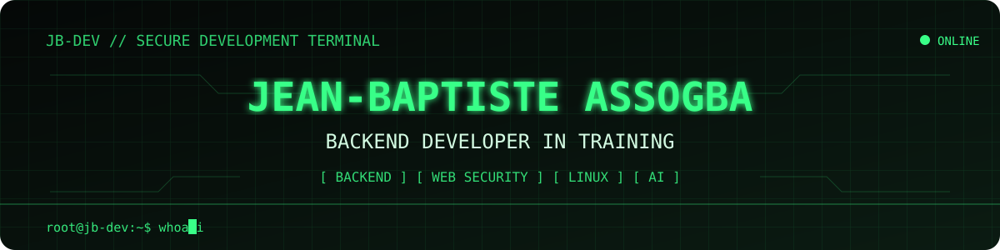
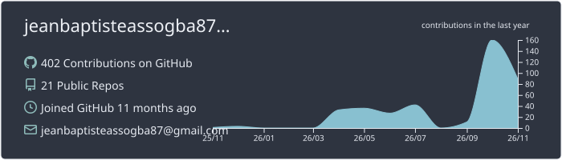
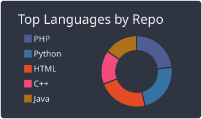
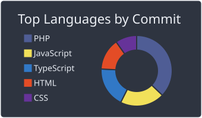
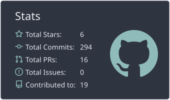
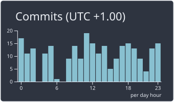

<div align="center">
  
</div>

<div align="center">

[](https://git.io/typing-svg)

[](https://github.com/jeanbaptisteassogba87-jpg)
[](https://www.linkedin.com/in/jean-baptiste-assogba-775271330)
[](mailto:jeanbaptisteassogba87@gmail.com)


</div>

---

<div align="center">

[ `ABOUT` ](#-whoami) · [ `FOCUS` ](#-areas-of-interest) · [ `STACK` ](#-tech-stack) · [ `PROJECTS` ](#-selected-projects) · [ `STATS` ](#-github-telemetry) · [ `CONTACT` ](#-connect)

</div>


## `> whoami`

<table>
<tr>
<td width="62%" valign="top">

### 🇫🇷 À propos

Bonjour ! Je suis **Jean-Baptiste Assogba**, étudiant en **Licence 3 — Systèmes Informatiques et Logiciels (SIL)** à **UATM GASA Formation**, au Bénin.

Je m'intéresse particulièrement au **développement Backend**, à la conception d'API et à la construction d'applications web. Je développe progressivement mes compétences en développement Full Stack et je découvre les pratiques de **cybersécurité** et de sécurisation des applications Web.

J'utilise ce profil pour documenter mon apprentissage, partager mes projets et progresser à travers la pratique.

**Objectif :** devenir un développeur Backend / Full Stack solide, attentif à la qualité du code et à la sécurité des applications.

### 🇬🇧 About me

Hello! I'm **Jean-Baptiste Assogba**, a third-year **Software and Information Systems** student at **UATM GASA Formation**, Benin.

I'm especially interested in **Backend Development**, API design, and web application development. I'm also growing my Full Stack skills while learning the fundamentals of **cybersecurity** and web application security.

I use this GitHub profile to document my learning journey, share projects, and improve through hands-on practice.

**Goal:** become a skilled Backend / Full Stack Developer who builds maintainable and security-conscious applications.

</td>
<td width="38%" valign="top">

### `> system_profile`

```text
USER       : Jean-Baptiste
ROLE       : Backend Developer
STATUS     : In training
EDUCATION  : Licence 3 SIL
SCHOOL     : UATM GASA Formation
LOCATION   : Benin
OS         : Fedora Linux
INTERESTS  : Backend / Full Stack
             Web Security / AI
MODE       : Learn - Build - Improve
```

</td>
</tr>
</table>


## `> areas_of_interest`

<div align="center">


</div>

- **Backend engineering:** server-side logic, REST APIs, authentication, databases and application architecture.
- **Web application security:** understanding common vulnerabilities and secure development practices.
- **Ethical hacking:** learning security testing concepts in authorized labs and environments only.
- **Linux:** daily use and exploration of Fedora Linux.
- **Artificial intelligence:** interest in Python, machine learning and practical AI projects.


## `> tech_stack`

> Technologies and tools I have worked with or am currently learning. This list is not a claim of equal proficiency in every tool.

<div align="center">

### Languages


### Backend & Frameworks


### Databases


### Tools & Environment


</div>

<div align="center">


</div>


## `> selected_projects`

A selection of repositories from my learning and development journey. Open each repository to see its README, implementation details and current state.

| Repository | Focus |
|---|---|
| [**reservation-hotel**](https://github.com/jeanbaptisteassogba87-jpg/reservation-hotel) | Hotel reservation application — academic / full-stack project |
| [**react-learning**](https://github.com/jeanbaptisteassogba87-jpg/react-learning) | React learning exercises and practical experiments |
| [**biblio-api**](https://github.com/jeanbaptisteassogba87-jpg/biblio-api) | API project — see repository for implementation details |
| [**projet-stockage-memoires**](https://github.com/jeanbaptisteassogba87-jpg/projet-stockage-memoires) | Academic project for storing and managing dissertations |
| [**CodeAlpha_Ecommerce**](https://github.com/jeanbaptisteassogba87-jpg/CodeAlpha_Ecommerce) | E-commerce project |


## `> currently_learning`

```bash
┌──(jb㉿fedora)-[~/learning]
└─$ cat roadmap.txt

[+] Backend development and API design
[+] React and Full Stack development
[+] Linux / Fedora environment
[+] Web application security fundamentals
[+] Ethical hacking fundamentals (authorized practice)
[+] Artificial Intelligence and Python
```


## `> github_telemetry`

<div align="center">


<br />


</div>

### `> automated_profile_cards`

The cards below are generated by the GitHub Actions workflow included in this repository. They may take a first workflow run to appear.

<div align="center">







</div>


## `> connect`

<div align="center">

[](https://www.linkedin.com/in/jean-baptiste-assogba-775271330)
[](mailto:jeanbaptisteassogba87@gmail.com)
[](https://github.com/jeanbaptisteassogba87-jpg)

</div>

<div align="center">

```text
root@jb-dev:~$ echo "Learn continuously. Build responsibly. Secure by design."
Learn continuously. Build responsibly. Secure by design.
```


<sub>© Jean-Baptiste Assogba · Built with curiosity, code and consistency.</sub>

</div>
